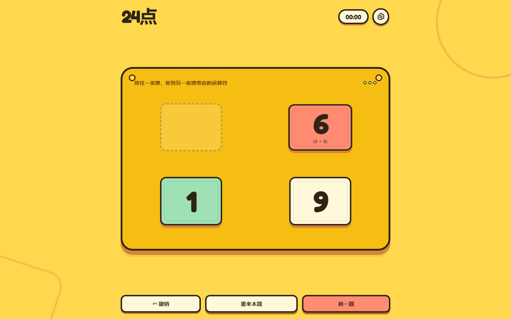

# 24点积木

打开就能玩的单人 24 点游戏。按住一张数字牌，拖到另一张牌上、下、左、右的运算符上松开，把两张牌合并成计算结果。四张牌合并到只剩一张，并且结果为 24 即获胜。

游戏支持鼠标、触控和触控笔，采用固定 2×2 牌位，适合电脑、手机和 iPad。



## 玩法

- 上方运算符是加，下方是减，左侧是乘，右侧是除。
- 运算方向固定为“被拖动数 op 目标数”。把 `6` 拖到 `2` 下方的减号，结果是 `6 − 2 = 4`，并且结果留在 `2` 原来的位置。
- 每张牌只能使用一次，中间结果允许出现负数与分数。
- 下方可以撤销、重来本题或换一题。
- 设置中可选择 `1–9` 或 `1–13`，也可以允许出现无解题目。
- 每题使用正计时。换题归零；重来本题和撤销失败结果会继续累计。

首版不含音效、账号、排行榜或联机功能。

## 本地运行

需要 Node.js 20 或更高版本。

```powershell
npm install
npm run dev
```

打开终端中显示的本地地址即可开始游戏。

## 测试与构建

```powershell
npm test -- --run
npm run test:e2e
npm run build
npm run preview
```

浏览器测试默认调用本机 Microsoft Edge，不额外下载 Chromium。

## 技术结构

- `src/core/`：精确分数、24 点求解器、随机出题、牌局状态、计时和设置。
- `src/ui/`：DOM 渲染、拖拽预览、设置面板和控制按钮。
- `src/styles.css`：黄色积木视觉、响应式布局和减少动态效果支持。

生产构建为纯静态文件，`vite.config.ts` 使用相对资源路径，可由 GitHub Pages 直接托管。

## GitHub Pages

仓库包含 `.github/workflows/deploy.yml`。推送到 `main` 后，GitHub Actions 会运行单元测试、构建 `dist/` 并部署到 Pages。

