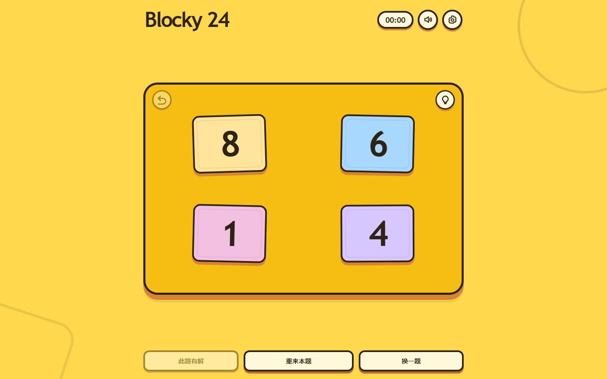

# Playbox

Playbox 是一个持续更新的浏览器小游戏收藏盒。每个游戏都能直接在电脑、手机或平板上打开，不需要安装客户端。

[**打开 Blocky 24**](https://BreadQiu.github.io/Playbox/) ·
[**直接玩 Blocky 24**](https://BreadQiu.github.io/Playbox/blocky-24/)

## 游戏架上

### Blocky 24 · v0.3.0

黄色积木风的拖拽式 24 点游戏。把一张数字牌拖到另一张牌旁边的运算符上，用四则运算逐步合并，最后得到 24。

- 鼠标、触控和触控笔都使用同一套拖拽操作。
- 数字范围可选 `1–9` 或 `1–13`，并可在设置中允许出现无解题。
- 精确分数计算支持负数、除法与中间分数。
- 计时、撤销、重来、提示、有解检查和下一题状态完整联动。
- 默认使用“喜剧卡通”程序化音效，可在页面右上角静音。
- 添加 `?sound=tactile` 可试听“积木实体”音色，`?sound=comedy` 可显式选择默认音色。

详细改动见 [v0.3.0 发布说明](docs/releases/v0.3.0.md)。

更多不同类型的游戏会继续加入 `games/`。

## 许可

[MIT](LICENSE) © 2026 Playbox contributors
